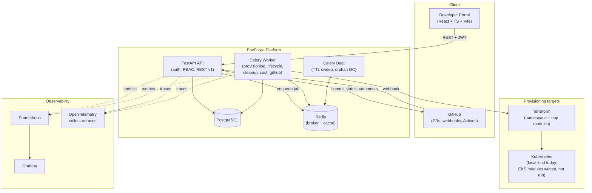
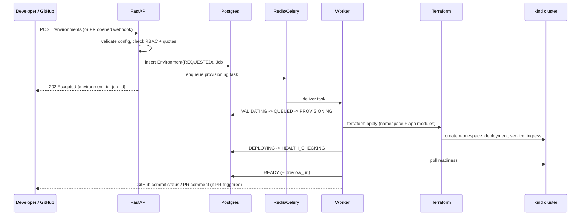

# EnvForge Architecture

## System overview

## Request / provisioning flow (target shape, built across Phases 2–3)

## Why these choices

- **FastAPI + async SQLAlchemy**: the API never blocks on provisioning —
  every mutating environment endpoint enqueues a Celery task and returns
  immediately, per the spec's "API should not block" requirement.
- **Domain logic lives in `app/services/*`, not in routers.** Routers stay
  thin (parse request → call service → map to response) so the lifecycle
  state machine, RBAC matrix, and provisioning pipeline are each testable in
  isolation and have exactly one implementation each.
- **Local JWT auth is always available**; GitHub OAuth activates only when
  `GITHUB_OAUTH_CLIENT_ID/SECRET` are configured. This means the whole
  platform is demoable with zero external accounts, while still having a
  real OAuth path for when it's configured.
- **Terraform + kubectl against a real local `kind` cluster**, not a mocked
  provisioner. The alternative (fake "provisioning" that just flips a
  database flag) would contradict the spec's explicit "do not implement
  fake integrations" requirement — so Phase 3 bootstraps an actual local
  Kubernetes cluster and applies actual Terraform against it.
- **Celery beat for TTL/cleanup** rather than a cron hitting an HTTP
  endpoint: keeps scheduling inside the same task infrastructure used for
  provisioning, so retries/backoff/observability are uniform.

See [`docs/roadmap.md`](roadmap.md) for phase-by-phase status and the
explicit list of what's simulated vs. real.
